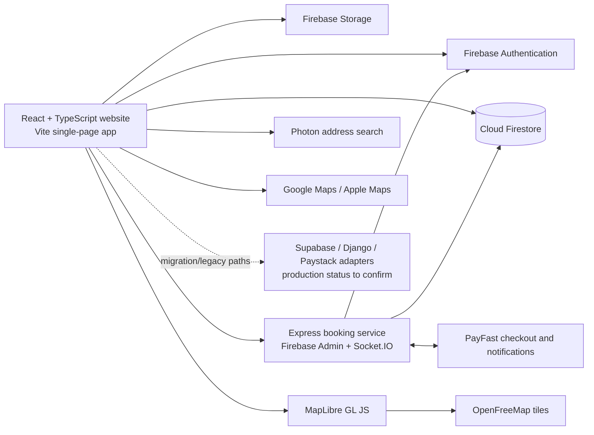
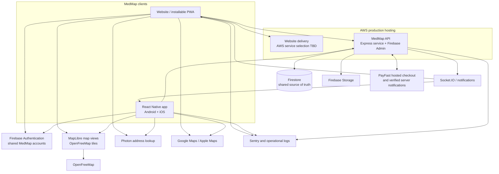
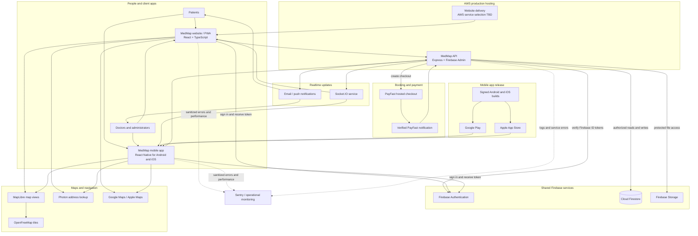

# MedMap Website and Mobile App — Solution Architecture

**Status:** Working proposal for review  
**Purpose:** Finish the agreed website scope, then build an Android and iOS app on the same MedMap accounts and backend, with AWS as the final production host.

## Recommendation

Keep one MedMap data and service layer for the website and mobile app. Build the store-distributed mobile app with React Native and TypeScript, reusing API contracts, validation, and business rules where practical. The app will have its own mobile screens; the website's browser UI cannot be reused directly as native UI.

AWS is confirmed as the final production host. The repository currently uses Firebase Authentication and Firestore and includes an Express booking service that uses Firebase Admin and PayFast. The proposal keeps Firebase Auth, Firestore, and Storage as managed backend services while AWS hosts the production website and MedMap API; a migration of Firebase services to AWS has not been specified. The repository also contains older Supabase/Django/Paystack integration code, which should be checked to establish whether it is retired or still active.

## Current system observed in the codebase

The website is a React 18 and TypeScript single-page app built with Vite. The frontend initializes Firebase Auth, Firestore, and Storage. The booking service is a separate Express/Socket.IO server; it verifies Firebase ID tokens and uses Firebase Admin to work with Firestore. PayFast is integrated into that service. The map uses MapLibre with OpenFreeMap tiles; address lookup uses Photon, and the “Drive there” links open Google Maps or Apple Maps.

The repository currently has configuration for both Netlify and Firebase Hosting, while AWS is the confirmed final production host. The active payment/API endpoints should still be confirmed before app implementation.

Those Netlify/Firebase Hosting settings and the current Render API URL are existing repository configuration, not the target production design. Replace them as part of the AWS deployment setup. AWS service choices for static website delivery and API hosting still need to be selected.

## Proposed target architecture

### Main components

| Component | Responsibility |
|---|---|
| AWS production hosting | Serves the production website and MedMap API. Select the AWS services, domains, secrets, deployment pipeline, and staging/production environments during deployment design. |
| Website | Public provider search, profiles, booking, doctor availability and practice management. Continues to work in desktop and mobile browsers. |
| Mobile app | Patient and, if included in the agreed scope, doctor workflows on Android and iOS. Uses the same accounts and backend as the website. |
| Firebase Authentication | Shared sign-in and identity. Both clients obtain Firebase ID tokens; the API verifies tokens and role permissions. |
| MedMap API | Shared business boundary for booking, availability changes, membership, payments, and other sensitive operations. Validates inputs and permissions before changing records. |
| Firestore and Storage | Shared application records and uploaded files, subject to reviewed access rules. |
| PayFast | Hosted payment experience. The server verifies PayFast notifications and updates the authoritative booking/payment status. Card/payment credentials remain with PayFast. |
| Maps | MapLibre renders practice pins using OpenFreeMap tiles. Selecting “Drive there” hands off the destination to the user's Google Maps or Apple Maps app/site. |
| Realtime and notifications | Updates clients when booking or availability state changes; sensitive data is fetched with the user's authorization. |

## End-to-end solution diagram

This diagram shows the complete proposed production setup, from a patient or provider using MedMap through AWS, Firebase, booking and payment processing, realtime updates, maps, monitoring, and mobile app distribution. AWS will host the production website and API; the specific AWS hosting services remain to be selected. Firebase is shown as the shared identity and data platform in this proposal.

In a booking, the client signs in, sends its Firebase ID token with the request, and asks the API to reserve an available slot. The API validates the user and slot, writes the booking, and starts PayFast checkout when payment is due. PayFast sends its result back to the API, which verifies the notification and updates the booking/payment state. The API can then publish a realtime update. Map rendering and address lookup use their map services directly from the client, while directions open the user's chosen navigation app.

## Important user flows

### Search and directions

1. A patient searches by province, specialty, name, or supported practice location data.
2. The website or app requests provider results from a public, field-filtered API response.
3. The map displays only providers with valid, publishable coordinates.
4. The user selects a provider and chooses Google Maps or Apple Maps for navigation.

### Booking and payment

1. The patient signs in through Firebase Authentication.
2. The client requests current provider availability from the MedMap API.
3. The API verifies the Firebase identity, checks role and slot availability, and creates the booking safely against concurrent requests.
4. If payment is due, the API creates a PayFast checkout and returns the checkout URL.
5. PayFast sends its payment notification to the server. The server verifies it and updates the payment and booking records.
6. The website and app show the resulting state through the API and/or an authorized realtime update.

### Doctor availability and practice address

1. A doctor or administrator signs in and updates availability or practice details.
2. The API checks that the user is permitted to change that doctor's records.
3. Address lookup proposes a pin; the doctor/admin can adjust it before saving.
4. Only fields approved for public display are returned in search and profile responses.

## Security and privacy boundaries

- Treat the server as authoritative for bookings, availability conflicts, memberships, refunds, and payment status. Never trust a client-supplied price, role, or payment result.
- Verify Firebase ID tokens on every protected API request and enforce patient, doctor, and admin permissions server-side.
- Keep PayFast credentials and webhook verification secrets on the server. The app and website only receive a hosted checkout URL and safe status data.
- Review Firestore rules before mobile launch. The current rules allow any signed-in user to read doctor documents; ensure private contact or practice data is not exposed in a document available to all signed-in users. Prefer API responses with explicit public fields for directory search.
- Minimize patient health information returned to clients and third parties. Do not send sensitive patient data to maps, analytics, or crash reports. Apply POPIA retention, consent, and access requirements to both clients.
- Keep map pins limited to practice addresses that the doctor/admin has chosen to publish.

## Website-to-app transition plan

1. **Complete the website scope.** Agree and finish the required login, profiles, availability, bookings, payments, maps, and admin workflows.
2. **Confirm production services.** Identify the Firebase project, booking API, payment gateway, and any still-active Supabase/Django paths; select AWS services for website and API hosting.
3. **Stabilize shared contracts.** Document and version the API endpoints, request/response schemas, auth rules, error formats, and booking/payment state transitions. Move critical client-side writes behind the shared API as needed.
4. **Prepare mobile foundations.** Set up the React Native app, shared TypeScript API types/validation, environment configuration, crash reporting, and secure token/session handling.
5. **Build agreed mobile journeys.** Implement patient and doctor features from the signed-off scope, using the same backend records and workflows as the website.
6. **Test and release.** Test on real Android and iOS devices, verify accessibility and privacy behavior, then submit signed builds to Google Play and Apple App Store.

## Decisions to confirm before app development

1. **Distribution:** Store-listed Android/iOS app, or an installable PWA without store listings? This proposal assumes store-listed apps.
2. **User scope:** Patient-only app for the first release, or patient and doctor features together?
3. **Production backend:** Confirm Firebase/Firestore + the Express booking service + PayFast are the live source of truth, and identify whether Supabase/Django/Paystack code is retired or still used.
4. **AWS implementation:** Select the AWS services for website delivery and API hosting, and define domains, secrets, deployment pipeline, and staging/production environments. Confirm whether Firebase Auth, Firestore, and Storage remain the managed identity and data services.
5. **Launch requirements:** Confirm push notifications, offline access, in-app telemedicine, and any other features that must be in the first mobile release.

This document is a proposed architecture based on the current repository. It should be updated after the production services and first-release app scope are confirmed.
